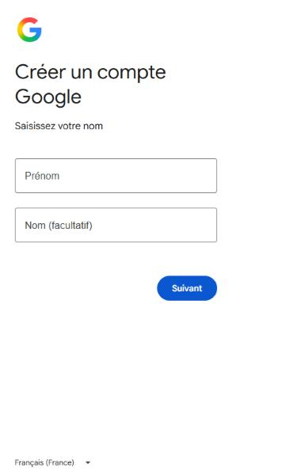
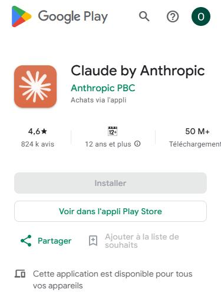
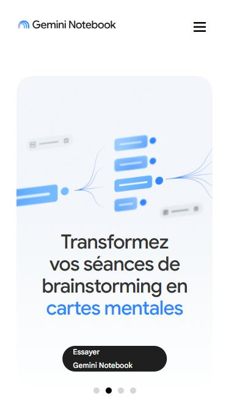

::: objectifs
- Vous créez votre compte Claude et installez l'application sur votre téléphone.
- Vous créez ou vérifiez votre compte Google pour Google Drive et NotebookLM.
- Vous ouvrez votre dossier personnel (portfolio) et rejoignez le groupe WhatsApp du parcours.
:::

## Pourquoi c'est utile

Pendant tout le parcours, vous travaillez avec quatre outils : Claude pour produire, Google Drive pour déposer vos travaux, NotebookLM pour réviser, WhatsApp pour poser vos questions. Avec des comptes prêts dès le premier jour, chaque séance commence par du travail utile, pas par des problèmes techniques. Ces mêmes comptes vous serviront ensuite pour vos propres projets et vos clients.

Durée : environ 30 minutes. Appareil : votre smartphone suffit.

## Avant de commencer

- [ ] Votre téléphone est chargé et connecté à Internet (Wi-Fi si possible : moins de forfait consommé).
- [ ] Vous avez accès à votre boîte e-mail sur ce téléphone.
- [ ] Vous avez 18 ans ou plus.
- [ ] Vous notez vos mots de passe dans un endroit sûr, jamais dans un groupe WhatsApp.

## Étape 1 : créer votre compte Google

Si vous avez déjà une adresse Gmail, passez directement à l'étape 2.

1. Ouvrez votre navigateur et allez sur **accounts.google.com/signup**.
2. Saisissez votre prénom et votre nom, puis votre date de naissance.
3. Choisissez une adresse Gmail simple et professionnelle, par exemple prenom.nom@gmail.com. Évitez les surnoms.
4. Choisissez un mot de passe long (au moins 12 caractères).
5. Ajoutez votre numéro de téléphone pour sécuriser le compte et confirmez avec le code reçu par SMS.

## Étape 2 : créer votre compte Claude

1. Ouvrez **claude.ai** dans votre navigateur.
2. Choisissez **Continuer avec Google** et sélectionnez le compte Google de l'étape 1. C'est la méthode la plus simple : un seul compte pour tout le parcours.
3. Saisissez votre nom complet.
4. Lisez et acceptez les conditions d'utilisation d'Anthropic.
5. Si Claude vous demande un numéro de téléphone, saisissez-le et confirmez avec le code reçu.

Pendant la séance de lancement, le formateur montre ces écrans en direct sur un téléphone réglé en français. Les captures seront ajoutées ici après la séance.

## Étape 3 : installer l'application Claude

1. Ouvrez **Play Store** (Android) ou **App Store** (iPhone).
2. Recherchez **Claude** et vérifiez que l'éditeur est **Anthropic**.
3. Installez l'application, ouvrez-la et connectez-vous avec le même compte Google.

## Étape 4 : tester Claude

Écrivez votre premier message dans Claude. Copiez exactement cette consigne :

::: prompt
Bonjour Claude. Je commence aujourd'hui une formation pour apprendre à travailler avec toi. Présente-toi en trois phrases simples, puis donne-moi trois exemples concrets de ce que tu peux faire pour un commerçant à Douala.
:::

Lisez la réponse. Si elle s'affiche, votre compte fonctionne.

## Étape 5 : ouvrir NotebookLM

1. Ouvrez **notebooklm.google.com** dans votre navigateur. La page d'accueil peut s'afficher sous le nom **Gemini Notebook** : touchez **Essayer Gemini Notebook**.
2. Connectez-vous avec votre compte Google.
3. Vous ne créez rien aujourd'hui : vous vérifiez seulement que la page s'ouvre.

Google présente désormais cet outil sous le nom « Gemini Notebook ». Dans ce parcours, nous disons encore souvent « NotebookLM » : il s'agit du même service. Si Google vous demande de vérifier votre âge, faites-le dans votre compte Google.

## Étape 6 : ouvrir votre portfolio dans Google Drive

1. Vous recevez un e-mail d'invitation « OKOHO Académie · Portfolio · [votre prénom] ».
2. Ouvrez le lien et ajoutez le dossier à votre Drive.
3. Installez l'application **Google Drive** sur votre téléphone si elle n'y est pas.
4. Dans votre dossier, ouvrez le document **Diagnostic d'entrée** : vous le remplirez pendant la séance de lancement.

## Étape 7 : rejoindre la communauté WhatsApp

1. Ouvrez le lien d'invitation envoyé par votre formateur.
2. Rejoignez le groupe **Cohorte 1** et le groupe **Annonces**.
3. Écrivez un message court : votre prénom, votre ville et votre objectif en une phrase.

::: coup-de-pouce
- Vous ne recevez pas le code par SMS ? Attendez deux minutes, vérifiez le numéro, puis demandez un nouvel envoi.
- Claude ne s'ouvre pas ? Fermez le navigateur, ouvrez une fenêtre de navigation privée, puis réessayez avec claude.ai.
- Rien ne fonctionne ? Faites une capture de l'écran et envoyez-la dans le groupe WhatsApp Cohorte 1. Quelqu'un vous aide.
:::

::: erreurs
- **Créer plusieurs comptes Claude.** Utilisez toujours le même compte Google, sinon vos conversations sont dispersées.
- **Partager un compte avec un proche.** Chaque participant a ses propres comptes : c'est une règle du parcours et des conditions d'utilisation.
- **Envoyer un mot de passe ou un code dans WhatsApp.** Un code de vérification ne se partage jamais, même avec le formateur.
:::

::: fil-rouge
Aïcha, couturière à Bonamoussadi, fait l'étape 4 le soir même. Claude lui propose trois idées : des messages WhatsApp pour annoncer ses nouveaux modèles, un tableau simple pour suivre ses commandes, une page web pour montrer ses créations. Elle garde la conversation : ce sera le point de départ de son projet.
:::

::: livrable
Dans votre dossier portfolio : une capture d'écran de la réponse de Claude à l'étape 4, nommée **A00-01_Prenom.png**. À déposer avant la séance du samedi 7 novembre 2026.
:::
